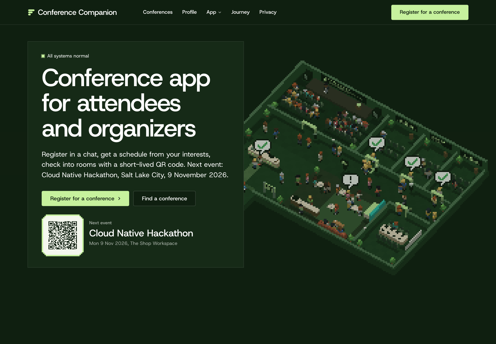
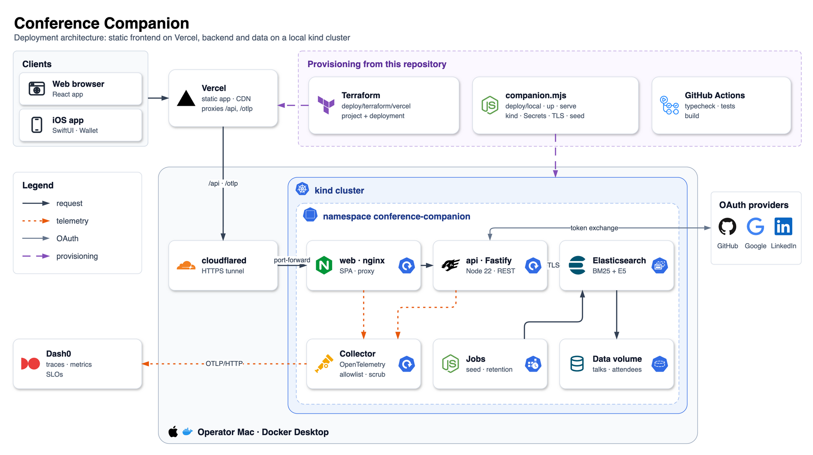

# Conference Companion

**From conference sign-up to the right talk, schedule, and room.**

A Cloud Native Hackathon submission for **“make conferences easier”** — Salt Lake City, 9 November 2026. Attendees register in a short chat, find talks using their own vocabulary, and check into rooms with a short-lived QR code. Organizers see aggregate interests and room-demand suggestions rather than individual profiles.

[](https://github.com/DL4P1N/Kubecon-2026/actions/workflows/ci.yml)

**[Open the app](https://conference-companion-ecan4.vercel.app)** · [Three-minute demo script (recording-time setup)](docs/storyboard-3min.md) · [Evidence ledger](docs/track-evidence.md) · [Design document](Conference%20Companion_%20Design%20Doc.md)



## Try the attendee journey

| Step | What to try |
| --- | --- |
| **Register** | [Chat sign-up](https://conference-companion-ecan4.vercel.app/site/register.html?c=cloud-native-hackathon-slc-2026) explains what is kept, collects interests, and creates a ticket and recommended schedule through the real API. The deployed chat uses scripted questions, not an LLM. |
| **Find a talk** | [Search](https://conference-companion-ecan4.vercel.app/search) compares keyword and hybrid retrieval over **417 real KubeCon NA 2026 sessions**, including the Elasticsearch request bodies. |
| **Plan the day** | [Schedule](https://conference-companion-ecan4.vercel.app/schedule) saves selected talks without overlaps and displays a short-lived room-access QR. Register first in the same browser tab. |
| **Check the door** | [Kiosk](https://conference-companion-ecan4.vercel.app/kiosk) accepts a camera scan or token-text alternative and checks current server-side entitlements on every scan. |
| **Understand demand** | [Interest map](https://conference-companion-ecan4.vercel.app/map), [clusters](https://conference-companion-ecan4.vercel.app/clusters), and [organizer view](https://conference-companion-ecan4.vercel.app/organizer) show aggregates; protected views require the organizer key. Groups smaller than five are suppressed. |
| **Inspect health** | [Status](https://conference-companion-ecan4.vercel.app/status) reports application health and in-process search measurements. These are not Dash0 SLO measurements. |

The [native iOS companion](ios/README.md) adds tickets, schedule, a floor plan, spoken directions, and signed Wallet-pass integration. It is a separate Xcode build, not an app installed by the website. Indoor positioning and other-attendee scenes include explicitly simulated signals/data; this is not a deployed venue-tracking system. Seven of the landing page's eight conference listings are fictional demo events.

## Architecture

The public frontend runs on Vercel. **The backend and user data stay on the operator Mac's Kubernetes cluster;** Vercel only serves static files and proxies `/api` and `/otlp` through an HTTPS tunnel.



Source: [`docs/architecture.drawio`](docs/architecture.drawio) (edit in draw.io, then re-export the PNG).

Search combines BM25 and Elasticsearch `semantic_text` (multilingual E5) with reciprocal rank fusion; catalog-vocabulary expansion applies to both. A Node CronJob computes k-means interest clusters and stores only aggregates. [Search implementation](api/src/search/queries.ts) · [Inference setup](docs/elasticsearch.md) · [Cluster design](docs/cluster-map.md).

### Technologies and hosting

| Layer | Technologies | Where it runs |
| --- | --- | --- |
| Web | React 18, TypeScript, Vite 6; vanilla ES modules and Three.js for the landing scene | Vercel static deployment; nginx copy in Kubernetes |
| API | Node.js 22, Fastify 5, Zod, signed JWT sessions/QR tokens | Kubernetes Deployment on the Mac |
| Data and retrieval | Elasticsearch 8.19.6, BM25, `semantic_text`, multilingual E5, RRF | Kubernetes StatefulSet; local persistent volume |
| Background work | Retention and interest-cluster jobs | Kubernetes CronJobs using the API image |
| Observability | OpenTelemetry JS/web SDKs, Collector, Dash0 | SDKs in app; Collector in Kubernetes; Dash0 hosted service |
| Kubernetes operations | Docker, kind, Radar UI and read-only MCP | Operator Mac; Radar inspects the dedicated cluster |
| Delivery and review | GitHub Actions, Vitest, Playwright/axe, Gitar project rules and PR reviews | GitHub / Gitar; local development tooling |
| Optional native app | SwiftUI, iOS 26+, QR and Wallet integration | Separately built and installed on an iPhone |

## Evidence, not just integrations

| Track | What we used it for | Inspect the evidence |
| --- | --- | --- |
| **Elasticsearch** | Real catalog, inference, hybrid search, schedules, and aggregate data. Vocabulary expansion improved the measured held-out paraphrases; it also improved keyword search. | [Shipped evaluation and limitations](docs/evidence/search-eval-52.md), [raw results](docs/evidence/search-eval-52.json), [comparison queries](docs/search-comparison.md) |
| **Dash0** | Browser → API → Elasticsearch trace, dashboards/SLOs, and a telemetry-privacy investigation with remediation. | [Trace proof](docs/evidence/live-smoke.md#browser--api--elasticsearch-proof), [live dashboard](docs/demo/dash0-live-dashboard-slos.jpg), [SLO pages](docs/demo/dash0-live-slo-list.jpg), [Agent0/MCP investigation](docs/evidence/dash0-agent0-investigation.md), [export privacy check](docs/evidence/dash0-privacy-live.json) |
| **Radar** | Live Kubernetes inspection, a safeguarded AI investigation of retained model-capacity errors, and resource sizing. The original ML-memory diagnosis used Elasticsearch APIs; Radar's later verdict and follow-up are distinguished. | [Actual investigation](docs/track-evidence.md#actual-radar-ai-investigation-task-30), [topology](docs/demo/radar-topology.png), [resource report](docs/evidence/radar-resources.md) |
| **Gitar** | Project-aware repository rules, review findings acted on during development, and explicitly requested CI-failure diagnosis. This is the Gitar entry; no Sonar tooling integration is claimed. | [Rules and fixes](docs/track-evidence.md#gitar-findings-acted-on), [CI diagnosis](docs/gitar-ci-diagnosis.md), [room-access audit-log fix PR](https://github.com/DL4P1N/Kubecon-2026/pull/75) |

Search measurement, same 417-talk index, eight held-out questions:

| Retrieval | Expansion off: hit@3 | Expansion on: hit@3 | MRR@10 off → on |
| --- | ---: | ---: | ---: |
| Keyword | 0/8 | 4/8 | 0.016 → 0.516 |
| Hybrid | 3/8 | 6/8 | 0.215 → 0.642 |

These are small, same-author judged sets, not a production A/B result. Dashboard/SLO captures cover a short observation window, not 28-day compliance.

[Live session-isolation and QR revoke/restore checks](docs/evidence/live-smoke.md#session-isolation-and-live-qr-revocation--70-deployed-9c047d7) used two synthetic attendees and the same QR across allow → deny → allow. The [offline recording](docs/demo/recording.md) is a labelled mock-API rehearsal, not live backend proof.

## Deploy reproducibly

**Local Kubernetes.** The [local runner](deploy/local/README.md) creates an isolated kind cluster, generates fresh credentials and TLS, builds the images, and deploys Elasticsearch, the app, the collector, and the jobs with the real 417-talk catalog. It never reads `.env` or touches your default kubeconfig. Needs about 8 GiB of Docker memory.

```sh
npm ci
node deploy/local/companion.mjs up --accept-elastic-trial   # flag = you accept Elastic's trial terms
node deploy/local/companion.mjs serve                        # http://127.0.0.1:8080
```

**Public frontend (optional).** [Terraform for Vercel](deploy/terraform/vercel/README.md) creates a new project and deploys the static build in front of your own HTTPS backend origin. Supply your own `VERCEL_API_TOKEN` and `team_id`. Generated secrets, kubeconfigs, artifacts, and Terraform state are git-ignored and excluded from image build contexts.

## Develop locally

**Prerequisites:** Node **22.15+**, npm, Docker, and memory for Elasticsearch's 4 GiB container plus inference and the application.

1. Run `npm ci` from the repository root.
2. Create a private `.env` using [.env.example](.env.example) as a reference; preserve any existing credentials. Configuration is read from environment variables, not automatically loaded from this file.
3. Follow the [secured Elasticsearch runbook](docs/es-deployment.md) to provision credentials, trusted CA, service-user permissions, licensing, and ML memory. Do not disable certificate verification. [Compose](deploy/compose/docker-compose.yml) supplies Elasticsearch and the collector; [observability setup](docs/observability.md#run-locally) covers collector credentials.
4. Load the API environment and initialize the catalog **once on a new environment**:

```sh
# API terminal; source only your own trusted local file.
set -a
. ./.env
set +a

npm run build
npm run es:init
npm run seed
npm run dev:api  # http://localhost:3000
```

In another terminal:

```sh
npm run dev:web  # http://localhost:5173; /site/ is the landing entry
```

The Vite server proxies `/api` and `/otlp`. OAuth linking requires provider client credentials and matching callback URLs; see [sign-in configuration](docs/sign-in.md). Provider links live in the browser and are **not** cross-device account login or profile synchronization. Keep OAuth client secrets on the API, never in `VITE_*` variables or the frontend bundle.

### Checks and guides

```sh
npm run typecheck
npm test
npm --prefix landing test
npm run test:a11y -w web  # requires the Playwright browser/dependencies
```

| Guide | Contents |
| --- | --- |
| [Reproducible local infrastructure](deploy/local/README.md) | Fresh kind cluster, generated credentials/TLS, catalog bootstrap, app, and jobs |
| [Optional Vercel Terraform](deploy/terraform/vercel/README.md) | Static frontend project/deployment, API rewrites, and public OAuth callbacks |
| [Kubernetes deployment](deploy/k8s/app/README.md) | Dedicated kubeconfig, Secrets, images, app rollout, seed, and port-forward |
| [Chat](docs/chat.md) | Scripted flow; optional Claude CLI mode and usage boundary |
| [Retention](docs/retention.md) / [clusters](docs/cluster-map.md) | Scheduled jobs, profile deletion, aggregation limits |
| [Telemetry](docs/observability.md) / [allowlist](docs/telemetry-allowlist.md) | SDKs, collector, scrubbing, and trace verification |
| [Radar](docs/radar.md) / [Dash0](docs/dash0.md) / [Gitar](docs/gitar.md) | Operator and sponsor-track setup |
| [iOS](ios/README.md) | Xcode build, server URL, signing, Wallet, and simulated features |

## Data, privacy, and demo boundaries

- **Storage:** profiles, schedules, entitlements, and aggregate results are Elasticsearch documents on the local Kubernetes volume. Vercel forwards requests to the API; only Elasticsearch writes that volume. Browser-local kept profiles/history are separate from server storage.
- **Retention:** registering keeps the profile for future conferences by default and includes aggregate-interest use; it is not a separate opt-in. A positive `ATTENDEE_RETENTION_HOURS` enables timed retention. `DELETE /api/me` is the profile-deletion endpoint. Read the [current policy and limitations](docs/retention.md), not the older 24-hour demo assumptions.
- **Access:** signed attendee sessions last eight hours; room QR tokens last about 60 seconds, use a separate audience, and are checked against current entitlements. Organizer access uses a separate key. [Token implementation](api/src/auth/token.ts).
- **Telemetry:** explicit allowlists exclude attendee identifiers, tokens, precise locations, and free-text answers. The committed privacy evidence is a bounded observation, not a universal audit. Elasticsearch has authenticated, CA-validated TLS; internal app/collector transport is **not** verified end-to-end TLS.
- **Current deployment:** the public site depends on the operator Mac staying awake with Docker, the port-forward, and the HTTPS tunnel running. The single-node volume is not a replicated database. The Cloudflare Quick Tunnel buffers the SSE registration feed (`/api/events`); live updates need a streaming-capable tunnel.
- **Known hardening work** (team board #78): stored opt-out handling, binding OAuth state to the initiating browser, deletion-error handling, and expired-record cleanup when timed retention is off. This is a hackathon demo, not a production-readiness claim.

## License

No project-wide license is declared in this repository. Vendored components retain their own notices and licenses.
