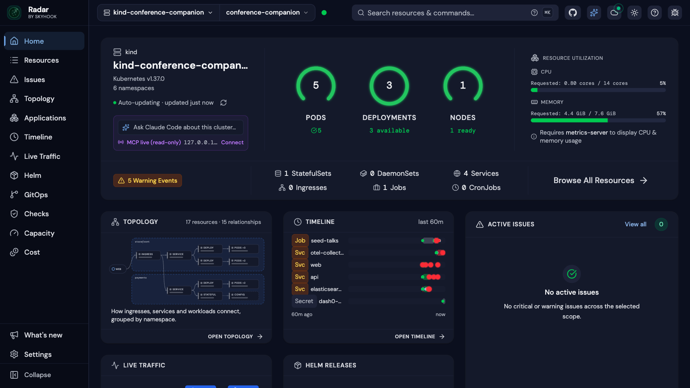
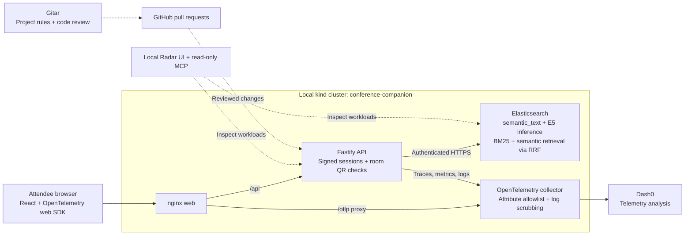

# Conference Companion

Find the right KubeCon talks, build a personal schedule without overlapping
sessions, and check into rooms with a short-lived QR code. Organizers can see
aggregate interests from attendees who opt in, while the team uses
Elasticsearch search, OpenTelemetry, Dash0, Radar, and Gitar to build and
inspect the application. See the [design document](Conference%20Companion_%20Design%20Doc.md)
and [demo evidence ledger](docs/track-evidence.md) for scope and observed results.

## What to try

| Experience | Route | Implementation and evidence |
| --- | --- | --- |
| Register (the page says what is kept and why), then get recommendations | `/register` → `/onboarding` | [Attendee flow](web/src/pages/Onboarding.tsx), [signed registration](api/src/routes/register.ts) |
| Save a personal schedule and display a short-lived room QR | `/schedule` | [Schedule authentication](https://github.com/DL4P1N/Kubecon-2026/pull/22), [QR/entitlement checks](https://github.com/DL4P1N/Kubecon-2026/pull/21) |
| Compare keyword and hybrid search, with Elasticsearch request bodies | `/search` | [Initial five-query results](docs/demo/search-comparison-measured.json), [measured 12-query report](https://github.com/DL4P1N/Kubecon-2026/pull/27#issuecomment-6749696162), [evaluation script](scripts/search-eval.ts); 5 wins, 7 ties, 0 losses, not a majority win |
| Scan a room QR or use its text alternative; reread entitlements on each scan | `/kiosk` | [Access implementation and tests](https://github.com/DL4P1N/Kubecon-2026/pull/21); live camera/cluster acceptance must be checked separately |
| Inspect topic counts and organizer-keyed clusters | `/map`, `/clusters` | [Aggregation](api/src/interests/aggregate.ts), [cluster design and limitations](docs/cluster-map.md); groups below five are suppressed, thresholds untested on real attendee data |

The screenshots below show the actual local Kubernetes environment, not an
attendee UI mockup. The [offline UI recording and screenshots](docs/demo/recording.md)
use visibly disclosed synthetic data and mock API responses; live attendee-flow
recording remains pending.



[Open the live-cluster topology screenshot](docs/demo/radar-topology.png).

## Architecture

This diagram shows component relationships. The [evidence ledger](docs/track-evidence.md)
distinguishes implemented paths from live verification; transport TLS exceptions
are tracked separately and must not be inferred from the diagram.



Elasticsearch embeds the real catalog through `semantic_text`; the API combines
keyword and semantic retrieval with RRF. The optional k-means job runs in Node,
with Elasticsearch storing its inputs and aggregate outputs. See
[search implementation](api/src/search/queries.ts), [catalog/inference setup](docs/elasticsearch.md),
and [cluster computation](docs/cluster-map.md).

## Run locally

Use **Node 22.15+**, npm, Docker, and enough memory for Elasticsearch's 4 GiB
container plus the application. The [secured ES runbook](docs/es-deployment.md)
contains certificate-volume setup, private credential provisioning,
`companion_svc` bootstrap, licensing, and the ML memory setting. Complete that
setup before seeding; never disable certificate verification.

```sh
npm ci
npm run build
npm test
# After the secured ES setup, with its service credentials and trusted CA loaded:
npm run es:init
npm run seed
```

Compose provides Elasticsearch and the collector; the development applications
run on the host. See [Compose ES setup](docs/es-deployment.md#local-compose)
and [telemetry setup](docs/observability.md#run-locally) for required environment
variables. Keep Dash0 credentials in the collector environment only.

Registration loads public talk tags from `GET /api/catalog/topics` (`{ topics: string[] }`).
This reads a keyword terms aggregation on `talks.tags` (up to 1,000 distinct tags),
not attendee interests. Empty user queries on `/api/search` remain invalid.
If the catalog is unavailable the form offers a retry rather than sending an
empty search. To smoke-test a deployed app without API mocks, set
`LIVE_APP_URL` to its origin and run `npm run test:a11y -w web -- --grep "live catalog"`.
The smoke test only reads catalog metadata and selects a checkbox; it creates no attendee.

```sh
# In separate terminals after configuring the dependencies:
docker compose -f deploy/compose/docker-compose.yml up -d elasticsearch otel-collector
npm run dev:api  # localhost:3000
npm run dev:web  # localhost:5173; proxies /api and /otlp
```

API configuration comes from environment variables, listed in
[.env.example](.env.example). Real secrets belong in local environment variables
or Kubernetes Secrets. [Telemetry](docs/observability.md) covers SDK startup,
collector allowlists, and the browser → API → ES trace verification procedure.

For Kubernetes, follow the [dedicated kind deployment runbook](deploy/k8s/app/README.md)
and [Radar runbook](docs/radar.md). They create an isolated kubeconfig, provision
Secrets, load local images, deploy dependencies/app, run the one-shot real-talk
seed, and port-forward the web Service. A health check verifies its own hop;
exercise the real registration/search/scan routes before presenting.

The [retention runbook](docs/retention.md) and
[cluster runbook](docs/cluster-map.md) cover scheduled jobs. The demo script,
synthetic seed, and recorded fallback are separate deliverables; check their
merge and verification status in the [evidence ledger](docs/track-evidence.md).

## Privacy and security

- Session tokens are signed; room QR tokens use a separate audience and about
  60-second expiry. Each scan checks the current entitlement and fails closed.
  [Token design](api/src/auth/token.ts), [scan checks](api/src/routes/access.ts).
- Interest views cover every registered attendee (not an opt-in) and suppress
  groups smaller than five. They expose aggregates; clustering centroids remain server-side.
  [Aggregation](api/src/interests/aggregate.ts), [cluster boundaries](docs/cluster-map.md).
- Attendee profiles are kept by default so the next conference can recommend
  talks from the first minute; set `ATTENDEE_RETENTION_HOURS=24` to delete them
  after that long instead. Door and session tokens stay short-lived. Attendees
  can delete their own profile with `DELETE /api/me` (see the runbook).
  [Retention behavior and validation limits](docs/retention.md).
- Telemetry uses explicit resource, trace, log, and metric allowlists, and
  scrubs URL query strings from log bodies. Attendee IDs, precise user
  locations, tokens, and free-text answers are prohibited by policy; the
  [privacy regression](https://github.com/DL4P1N/Kubecon-2026/pull/30) covers its
  tested flows. Additional raw URL/path findings are being investigated in
  board task #40; do not read the policy as complete live proof.
  [Allowlist](docs/telemetry-allowlist.md), [SDK/logging design](docs/observability.md).
- Application ES access uses `companion_svc`; admin bootstrap credentials are
  separate. ES has authentication and CA-validated TLS. Internal app/collector
  transport gaps are tracked honestly in the [live evidence](docs/track-evidence.md#evidence-boundaries).
  [ES deployment and permission checks](docs/es-deployment.md).

## Sponsor tracks

### Elasticsearch

[Real catalog and inference evidence](docs/track-evidence.md#judge-swimlanes-and-claim-gates),
[observed five-query comparisons](docs/demo/search-comparison-measured.json),
[evaluation/tuning PR #27](https://github.com/DL4P1N/Kubecon-2026/pull/27).
The [operator's measured report](https://github.com/DL4P1N/Kubecon-2026/pull/27#issuecomment-6749696162)
uses 12 hand-judged questions against 417 indexed talks: current hybrid won 5,
tied 7 and lost 0; hit@3 was 5/12 vs keyword 0/12, MRR@10 was 0.306 vs 0.017.
This does not meet the majority-of-12 win criterion. The other tested tuning
variants were no better; current configuration was retained. The
[measured report in the repository](docs/demo/search-eval-report.md) and
[updated comparison](docs/search-comparison.md) landed in
[PR #40](https://github.com/DL4P1N/Kubecon-2026/pull/40), separately from the evaluator.

### Dash0

[Dash0 evidence and pending items](docs/track-evidence.md#dash0),
[collector export/scrubbing observation](docs/track-evidence.md#evidence-boundaries),
[OpenTelemetry SDK PR #15](https://github.com/DL4P1N/Kubecon-2026/pull/15),
[privacy regression PR #30](https://github.com/DL4P1N/Kubecon-2026/pull/30).
Collector-to-Dash0 export and a synthetic attribute scrub were observed;
end-to-end trace, live SLO/dashboard, and Agent0/MCP investigation must pass
their own evidence gates. The privacy regression tests application spans/logs
and collector configuration; it does not run a real collector.

### Radar

[Deployment, real ML-capacity incident, and controlled-test boundaries](docs/track-evidence.md#radar),
[overview screenshot](docs/demo/radar-overview.png),
[topology screenshot](docs/demo/radar-topology.png),
[deployment and probe-fix PR #6](https://github.com/DL4P1N/Kubecon-2026/pull/6).
Radar UI and read-only MCP were used against the live kind namespace. The
original ES allocation diagnosis came from ES APIs. The later
[actual Radar AI run and verification](docs/track-evidence.md#actual-radar-ai-investigation-task-30)
is captured in [PR #37](https://github.com/DL4P1N/Kubecon-2026/pull/37);
its retained scaling-error finding is distinguished from current healthy
one-allocation serving.

### Gitar / Sonar track

[Acted-on findings](docs/track-evidence.md#gitar-findings-acted-on),
[repository-rule execution](docs/track-evidence.md#repository-rule-verification-task-34),
[PR #25 Gitar dashboard](https://github.com/DL4P1N/Kubecon-2026/pull/25#issuecomment-6749180455).
“Rules 1/1 met” proves the check ran on a config/docs PR; the probe finding was
acted on and tested during a **controlled** API outage. Functional validation
is disabled. An [explicitly requested retrospective CI diagnosis](docs/gitar-ci-diagnosis.md)
is verified; automatic CI-failure triggering and auto-apply remain unproven. This is a Gitar entry;
no Sonar tooling integration is claimed.
